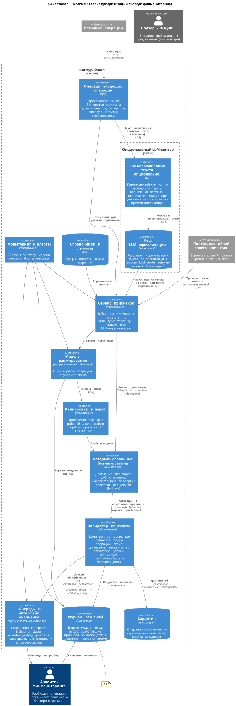
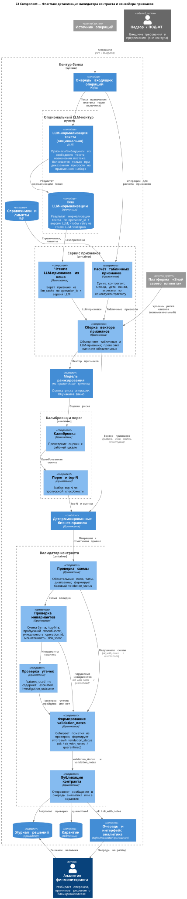

# Инициатива №1: сервис приоритизации очереди финмониторинга

## C4 Container

Ранее было принято решение, что сервис не выносит вердикт "схема / не схема" из-за недостатка данных для классификатора на этом этапе. Сервис меняет порядок очереди ручной проверки, модель ранжирования это единственное обучаемое звено. Остальное выполняет детерминированный код, человек и опциональная LLM-нормализация текста назначения перевода.

Исходник схемы — `diagrams/initiative-1_C4Container.puml`.

## 1. Таблица ответственности компонентов

| Компонент | Модель / код / человек | Причина | Цена ошибки |
| -- | -- | -- | -- |
| Приём операций (очередь) | Код | Буферизация, идемпотентность, retry-политика | Потеря операции, дубль в очереди |
| Оркестратор (диспетчер) | Код | Это единственное место, которое знает о сбоях и решает, куда перенаправить операцию | Без него недоступный компонент системы не может ничего перенаправить, а очередь не может сама проверить обязательность полей |
| Отложенная очередь (retry) | Код | Буферизация, идемпотентность, retry-политика | Потеря операций, которые не могут быть обработаны во время сбоя сервисов |
| LLM-нормализация текста (опционально) | Модель (LLM) | Свободный текст не удастся покрыть детерминированным словарём. Из текста нужно получить только признаки | Может создавать лишний шум в признаках (включается только при доказанном приросте результативности) |
| Кеш LLM-нормализации | Код | Чтобы retry не гонял LLM повторно и не оплачивал дважды | Повторная оплата LLM, раздувание счёта |
| Расчёт табличных признаков | Код | Агрегаты, справочники, детерминированная логика | Неверный признак приведет к неверной оценке |
| Оценка риска | Модель (ML) | Закономерность схемы по сочетанию признаков | Пропуск или ложная тревога |
| Калибровка и порог / top-N | Код + бизнес-решение | Приведение оценки к рабочей шкале, выбор top-N по пропускной способности | Неверный порог приводит к перегрузка аналитиков или пропуску схем |
| Детерминированные бизнес-правила | Код | Дробление под порог, дубли, лимиты, накопительные проверки; бизнес-правила работают без модели (fallback) | Пропуск явного нарушения или ложная блокировка |
| Валидатор контракта | Код | Единственное место, где решается судьба операции: схема, диапазоны, инварианты, утечки; формирует validation_status и validation_notes | Невалидный результат уходит в процесс |
| Очередь и интерфейс аналитика | Человек | Решение о блокировке/отказе, ответственность | Прямые потери или конфликт с клиентом |
| Карантин | Код | Изоляция критичных нарушений контракта до разбора | Критичное нарушение уходит в процесс |
| Журнал решений | Код | Воспроизводимость, аудит | Невозможно объяснить решение |
| Мониторинг | Код + человек | Сигналы по слоям, реакция на отклонения | Проблема обнаружена поздно |

## 2. Выходной контракт (сервис приоритизации, не классификатор)

Выходной контракт — это формат сообщения, которое валидатор отдаёт в очередь аналитика. Аналитик видит поля этого сообщения в интерфейсе. Пометки ("правила не распознаны", "оценка недоступна" и т.д.) — это значения поля `validation_notes`.

Сервис не выносит вердикт "схема / не схема". Выходной контракт — упорядоченный список операций с оценкой риска и сработавшими признаками.

Для этой инициативе масштаб времени — не real-time. Поэтому работа производится порциями — батч — пачкой операций за один прогон (например, за час, и т.д.). Батчем проще обеспечить согласованность top-N и производительность ранжирования (векторные операции, по одной — дорого). `rank` это место операции внутри батча.

Ранее было решено, что использование для нормализации текста назначения операции LLM — опционально (только если дает прирост). Поэтому для аудита и воспроизводимости используется флаг `llm_normalization`, чтобы понимать, решение модель приняла с учетом LLM-нормализации или нет. Если будет понятно, что LLM эффекта не дает, её можно исключить и просто изменится значение флага, не трогая модель ранжирования.

| Поле | Формат | Обязательность | Проверка | При нарушении |
| -- | -- | -- | -- | -- |
| `operation_id` | строка | обязательно | Есть в справочнике операций (в системе), уникален внутри батча | `quarantined`: операция не идёт в очередь аналитика, алерт дежурному |
| `rank` | целое [1...] | обязательно | Уникален в пределах батча, top-N в допуске пропускной способности | `quarantined`: батч не публикуется, алерт |
| `risk_score` | число [0,0..1,0] | обязательно (может быть `null` при fallback) | В диапазоне, не `NaN` | `ok_with_notes`: "оценка недоступна" |
| `fired_rules` | список кодов правил | обязательно (может быть пустым) | Коды есть в справочнике правил | `ok_with_notes`: "правила не распознаны" |
| `features_used` | список названий применённых признаков | обязательно | Названия есть в справочнике признаков, нет полей из разряда `escalated`, `investigation_outcome` (нет утечки из будущего) | `quarantined`: "утечка признаков" |
| `model_version` | строка | обязательно | Соответствует зафиксированной версии | `quarantined`: батч не публикуется, алерт |
| `llm_normalization` | bool | опционально | Согласовано с конфигурацией | — |
| `validation_status` | enum: `ok`, `ok_with_notes`, `quarantined` | обязательно (формирует валидатор) | Одно из трёх значений | — |
| `validation_notes` | список строк | обязательно (может быть пустым) | Строки из справочника пометок | — |

**Детерминированные инварианты (проверяет код в валидаторе до действия):**

- сумма операций в батче не превышает лимит батча
- top-N не превышает пропускной способности аналитиков (около 10 тыс. операций/мес)
- нет утечек из будущего: `features_used` не содержит `escalated`, `investigation_outcome`
- `risk_score` монотонен по top-N (сортировка проходит корректно)
- `operation_id` уникален в пределах батча.

**Три состояния операции на выходе валидатора:**

| Состояние | Что значит | Куда идёт |
| -- | -- | -- |
| `ok` | Всё в порядке | В очередь аналитика как валидная |
| `ok_with_notes` | Некритичное нарушение (оценка недоступна, правила не распознаны, признак недоступен) | В очередь аналитика с пометкой `validation_notes`, подсвечивается аналитику |
| `quarantined` | Критичное нарушение (`operation_id` нет в справочнике, утечка признаков, батч не сходится) | В карантин, алерт дежурному |

**Поведение при отсутствии данных:**

- если признак недоступен — операция не отбрасывается, а идёт в очередь с пометкой `ok_with_notes` ("признак недоступен")
- если модель недоступна — fallback, операция идёт через правила с пометкой `ok_with_notes` ("модель недоступна")

**Валидация до действия:**

- валидатор стоит между моделью и очередью аналитика
- всё, что не прошло контракт или инвариант, **не уходит в процесс**, а получает `ok_with_notes` или `quarantined`.

## 3. Fallback, эскалация и отказ

Здесь важно развести три разных сценария.

| Сценарий | Что значит | Куда идёт операция | Как помечается |
| -- | -- | -- | -- |
| **Fallback (обходной путь)** | Основной путь не дал результата, но есть обходной | В очередь аналитика через обходной путь | `ok_with_notes` с указанием, что основной путь недоступен |
| **Эскалация по качеству / риску** | Результат есть, но сомнительный или высокорисковый | В очередь аналитика | `ok_with_notes` с указанием причины |
| **Отказ (результата нет и обходного пути нет)** | Нет данных или критичный сбой | В карантин / retry / ограниченный режим | `quarantined` или retry |

### 3.1. Fallback (обходной путь)

| Признак | Реакция |
| -- | -- |
| Модель недоступна / тайм-аут | Fallback на детерминированные правила: операция проходит тракт `features → rules → validator` без модели, получает `ok_with_notes` ("модель недоступна"), идёт в очередь аналитика |
| LLM-нормализация недоступна (если включена) | Fallback на табличные признаки без LLM; операция проходит через `features` без LLM-признаков, получает `ok_with_notes` ("LLM-нормализация недоступна") |
| Кеш LLM-нормализации недоступен | Пересчёт LLM-нормализации при следующем запросе. Если LLM тоже недоступна — fallback без LLM-признаков |

### 3.2. Эскалация по качеству / риску (случай идёт человеку с пометкой)

| Признак | Почему | Реакция |
| -- | -- | -- |
| Оценка в зоне около порога | Модель неуверенна | `ok_with_notes` |
| Значение признака за границами обучающего диапазона | Модель не видела таких значений | `ok_with_notes` |
| Клиент/сегмент без истории (cold start) | Нет сигнала для оценки | `ok_with_notes` |
| Расхождение с сигналом правила (правило сработало, а модель нет, и наоборот) | Противоречие источников | `ok_with_notes` |
| Нужный признак отсутствует | Нет основания для оценки | `ok_with_notes` ("признак недоступен") |
| Операция относится к высокорисковому классу (крупная сумма, редкая схема, новый клиент) | Высокая цена ошибки | `ok_with_notes` |

### 3.3. Отказ (результата нет и обходного пути нет)

| Признак | Реакция |
| -- | -- |
| Сервис признаков недоступен | Retry во входной очереди (экспоненциальная задержка, лимит попыток). При исчерпании — `quarantined` ("признаки недоступны") + алерт дежурному. До валидатора операция не доходит, потому что без признаков нет данных для правил |
| Валидатор недоступен | Валидатор это критичный компонент: батч не публикуется + алерт дежурному |
| Превышены лимиты | Переходим в ограниченный режим: приём есть, разбор откладывается, алерт |
| Ошибка калибровки / порога | Батч не публикуется + алерт дежурному |

LLM-нормализация и сервис признаков у нас разведены, при этом сервис признаков может быть недоступен, но сервис LLM-нормализации доступен и успешно проведет нормализацию. Тогда чтобы Retry-политика для недоступности признаков не триггерила повторную LLM нормализацию по тексту назначения операции, результат этой нормализации надо сохранять в LLM-кэш (кэш по `operation_id` + версия LLM).

### Сохранение штатной очереди при сбое

Сбой сервиса признаков:

- Влияет только на новые операции.  
  Те операции, что уже в очереди — продолжают разбираться оператором.
- Штатная очередь эксперта не останавливается.  
  Эксперты продолжают работать с текущей очередью (отбор правилами и жалобами), которая формируется независимо от сервиса признаков.
- Предусмотрен маршрут для обязательных сигналов.  
  Операции, которые обязаны быть обработаны (крупные суммы, операции по 115-ФЗ, операции с высоким уровнем риска от внешней платформы), идут через детерминированные правила в обход сервиса признаков, они не ждут восстановления.
- Операции, которые не могут быть обработаны без признаков.  
  Уходят в отложенную очередь (retry), но не блокируют штатную очередь.
- После восстановления.  
  Выполняется сверка входного потока с очередью: какие операции пришли во время сбоя, какие были обработаны, какие остались. Пропущенные операции дозаливаются в очередь с пометкой "обработано после сбоя".

Сбой валидатора:

- Штатная очередь не останавливается.  
  Эксперты продолжают работать с тем, что уже в ней есть.
- Новые операции не публикуются в очередь эксперта до восстановления валидатора.  
  Без валидатора нельзя гарантировать контракт
- Предусмотрен маршрут для обязательных сигналов.  
  Операции, которые обязаны быть обработаны (крупные суммы, операции по 115-ФЗ, операции с высоким уровнем риска от внешней платформы), идут через упрощённую проверку (детерминированные правила без модели) и публикуются с пометкой "валидатор недоступен, проверено по упрощённой схеме".
- После восстановления.  
  Выполняется прогон накопленных операций через полный валидатор, сверка с упрощённой проверкой, разбор расхождений.

## 4. План мониторинга

| Слой | Сигнал | Событие | Реакция | Ответственный |
| -- | -- | -- | -- | -- |
| Вход | Доля операций с новыми контрагентами / новыми сегментами | Отклонение от обычного на N% | Проверить качество на новом сегменте | Владелец сервиса |
| Вход | Доля пропусков в признаках | Рост за неделю | Разбор: причина в источнике или модели | ML-команда |
| Вход | Доля операций, ушедших в retry | Рост | Разбор источника данных | Владелец сервиса |
| Модель | Доля операций в зоне около порога | Рост | Проверить калибровку, порог | ML-команда |
| Модель | Доля операций с оценкой за границами обучающего диапазона | Рост | Разбор, возможен пересмотр модели | ML-команда |
| Модель | Доля fallback-операций (модель недоступна) | Рост | Разбор доступности модели | Владелец сервиса |
| Очередь | Длина очереди аналитика | Выше согласованной | Ограниченный режим, приоритизация по ущербу, разбор причин | Руководитель финмониторинга |
| Очередь | Время ожидания в очереди | Выше согласованного | Приоритизация, уведомление | Руководитель финмониторинга |
| Очередь | Доля `ok_with_notes` | Рост | Разбор причин пометок | ML-команда + бизнес |
| Очередь | Доля `quarantined` | Рост | Разбор критичных нарушений | Владелец сервиса |
| Очередь | Доля исправлений во время проверки | Рост | Разбор: причина в модели, входе или строгости аналитика | ML-команда + бизнес |
| Очередь | Доля ошибок, найденных после подтверждения | Рост | Проверка формальности подтверждений | Владелец сервиса |
| Бизнес | Результативность проверок (подтверждённые / проверенные) | Падение против baseline | Выставляем "красный флаг" и идём разбираться к владельцу продукта | Владелец продукта |
| Бизнес | Удержанные суммы на проверку | Падение против baseline | Пересмотр целесообразности | Владелец продукта |
| Бизнес | Доля необоснованных блокировок | Рост | Guardrail: разбор и откат при необходимости | Владелец продукта + комплаенс |

**Метрики, которые могут привести к откату:**

- **разрыв в ряду признаков**  
  перевод в ограниченный режим, требуется разбор источника, возможен откат к предыдущей версии модели
- **рост доли необоснованных блокировок выше guardrail**  
  откат к предыдущей версии модели, возможно откат к детерминированным правилам
- **рост доли операций за границами обучающего диапазона + падение результативности**  
  как минимум повторный прогон на приёмочном наборе, возможен откат версии модели
- **рост доли `quarantined`**  
  разбор критичных нарушений, возможно откат конфигурации или модели.

Выборки для приемочного набора для честной оценки модели:

- случайная контрольная выборка (несмещённая оценка по всему потоку)
- риск-ориентированная выборка (редкие дорогие классы)
- оценка не только в среднем, но по сегментам (тип клиента, сумма и т.д.).

## 5. Угрозы на границах доверия

Номера границ соответствуют номерам с отметками на схеме `diagrams/initiative-1_C4Container.puml`.

| ## | Граница | Угроза | Что делаем |
| -- | -- | -- | -- |
| 1 | Внешние системы → очередь (**недоверенный вход**) | Подделка/искажение операции, инъекция в поля | Валидация схемы входа, проверка источника, идемпотентность по `operation_id`, карантин подозрительных записей |
| 2 | Очередь → LLM-нормализация (**недоверенный текст в назначении платежа**) | Инъекция промпта в назначении платежа попадает в контекст | Разделение инструкций и данных в промпте, ограничение роли LLM (только признаки, не решение), валидация выхода LLM как недоверенного ввода |
| 3 | Поставка LLM / весов / зависимостей (**недоверенный результат нормализации**) | Отравление весов, подмена зависимости, лицензионные ограничения | Проверка происхождения весов, фиксация версий зависимостей, чтение лицензии до развёртывания, регрессионный прогон при обновлении |
| 4 | Платформа "Знай своего клиента" → признаки (**внешний сигнал**) | Внешний сигнал воспринимается как истина | Вспомогательный сигнал: окончательную оценку банк делает сам, сигнал не заменяет правила и не отменяет процедуру |
| 5 | Модель → калибровка (**недоверенный ответ модели**) | Ошибка модели уходит дальше как истина | Валидатор контракта, детерминированные инварианты, калибровка, top-N по пропускной способности |
| 6 | Валидатор → очередь аналитика (**просачивание решения модели**) | Ответ модели попадает в интерфейс/процесс без обработки | Экранирование, типизация, проверка схемы. Аналитик видит признаки и источник (система только ранжирует и подсвечивает, а не выдает вердикт). `validation_notes` отображаются явно |
| 7 | Журнал ↔ мониторинг (**приватность**) | Журнал превращается в дубликат архива с ПДн | Минимизация записей, ограниченный срок хранения, доступ по ролям, маскирование |

**Границы, которых на схеме нет, но они есть в системе:**

- **Данные уходят наружу** — если LLM-нормализация вынесена в выделенный контур провайдера, то это отдельная граница. На текущей схеме LLM-нормализация отмечена в контуре банка. Но если контур поменяется, то нужно добавить в таблицу эту границу.
- **Инструменты и сервисные доступы** — в этой постановке инструменты модели не выдаются (никаких вызовов или обращений она делать не может). Но если появятся, то нужно добавить в таблицу эту границу.

## C4 Component (в виде Everything Diagram, т.е. всё на одной, как компромисс ради читаемости)

Исходник схемы — `diagrams/initiative-1_C4Component.puml`.

