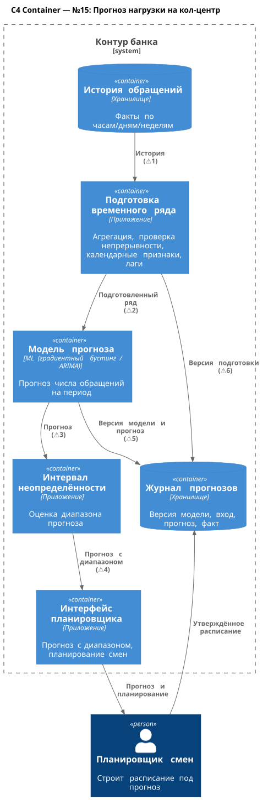

# Инициатива №15: сервис прогнозирования нагрузки на кол-центр

## C4 Container

Исходник схемы — `diagrams/initiative-15_C4Container.puml`.

## 1. Таблица ответственности компонентов

| Компонент | Модель / код / человек | Причина | Цена ошибки |
| -- | -- | -- | -- |
| История обращений | Код (источник) | Факты по часам/дням/неделям | Разрыв в ряду приведет к плохому прогнозу |
| Подготовка временного ряда | Код | Агрегация, проверка непрерывности, календарные признаки, лаги | Неверные признаки приводят к неверному прогнозу |
| Модель прогноза | Модель (ML) | Закономерность временного ряда | Недооценка (SLA) или переоценка (простои) |
| Интервал неопределённости | Код | Оценка диапазона прогноза | Ложная уверенность в прогнозе |
| Интерфейс планировщика | Код + человек | Показ прогноза с диапазоном, планирование смен | Неверное расписание |
| Планирование смен | Человек | Ответственность за расписание | Переработки/простои, SLA |
| Журнал прогнозов | Код | Версия модели, вход, прогноз, факт | Невозможно объяснить прогноз |

## 2. Угрозы на границах доверия

Номера границ соответствуют номерам с отметками на схеме `diagrams/initiative-15_C4Container.puml`.

| ## | Граница | Угроза | Что делаем |
| -- | -- | -- | -- |
| 1 | История обращений → подготовка ряда | Разрыв в ряду, пропуски, дубли, некорректная агрегация | Проверка непрерывности, документирование смены системы, карантин подозрительных периодов, сверка агрегатов |
| 2 | Подготовка ряда → модель | Неверные признаки (календарь, лаги, агрегаты) | Валидация признаков, проверка на утечки (нет фактов из будущего), версионирование подготовки |
| 3 | Модель → интервал неопределённости (выход модели) | Ошибка прогноза: недооценка (риск SLA) или переоценка (простои). Модель уверена там, где не должна | Проверка диапазона, интервал неопределённости, сверка с baseline (например, "как в прошлую неделю"), проверка на выбросах и праздниках |
| 4 | Интервал → интерфейс планировщика | Ложная уверенность в прогнозе, планировщик принимает прогноз за факт | Явный показ диапазона, а не одного числа. Вывести предупреждение на периодах с высокой неопределённостью |
| 5 | Журнал ↔ доступ | Журнал содержит данные о нагрузке, но также могут попадать и чувствительные данные | Минимизация, ограниченный доступ, маскирование. Нужен контроль DPO |
| 6 | Поставка модели (веса, зависимости) | Подмена зависимости, лицензионные ограничения | Фиксация версий, проверка лицензии, регрессионный прогон при обновлении |

В данной инициативе угроза на выходе модели — не подделка и не инъекция, а ошибка прогноза. Она гасится не валидатором контракта, а интервалом неопределённости и сверкой с baseline. Т.е. граница доверия на выходе модели всё равно есть, просто способ проверки другой.
