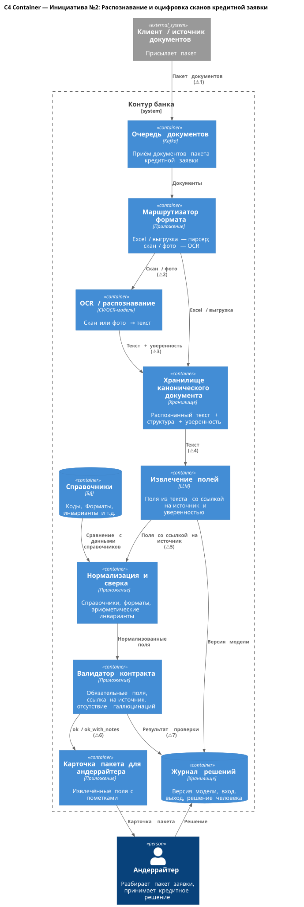

# Инициатива №2: сервис распознавания и оцифровки сканов кредитной заявки

## C4 Container

Исходник схемы — `diagrams/initiative-2_C4Container.puml`.

## 1. Таблица ответственности компонентов

| Компонент | Модель / код / человек | Причина | Цена ошибки |
| -- | -- | -- | -- |
| Приём документов (очередь) | Код | Буферизация, идемпотентность по документу | Потеря или дубль документа |
| Маршрутизация формата | Код | Признак явный (расширение, тип файла, наличие текстового слоя) | Документ ушёл не по тому пути |
| OCR / распознавание | Модель (CV/OCR) | Нужно преобразовать скан/фото в текст. Обучаемая задача | Неверный текст приведет к неверным полям |
| Хранилище канонического документа | Код | Переиспользование результата распознавания, ведение версионирования документов | Потеря структуры, невозможность диагностики |
| Извлечение полей | Модель (LLM) | На входе свободный текст, нужно извлечь поля со ссылкой на источник в оригинальном документе | Галлюцинация, пропуск поля |
| Нормализация и сверка | Код | Справочники, форматы, арифметические инварианты | Неверное значение уходит дальше |
| Валидатор контракта | Код | Обязательные поля, ссылка на источник, отсутствие галлюцинаций | Невалидный результат уходит в карточку |
| Карточка пакета для андеррайтера | Код + человек | Показ извлечённых полей с пометками | Андеррайтер не видит, что не сошлось |
| Кредитное решение | Человек | Ответственность, ПДн, регуляторика | Неверное кредитное решение |
| Журнал решений | Код | Воспроизводимость, аудит | Невозможно объяснить решение |

## 2. Угрозы на границах доверия

Номера границ соответствуют номерам с отметками на схеме `diagrams/initiative-2_C4Container.puml`.

| ## | Граница | Угроза | Что делаем |
| -- | -- | -- | -- |
| 1 | Внешний клиент → очередь документов | Подделка документа, искажение полей, инъекция в метаданные, документы не от того клиента | Валидация схемы входа, проверка источника и владельца заявки, идемпотентность по идентификатору документа, карантин подозрительных файлов |
| 2 | Скан/фото → OCR | Низкое качество скана, искажение, подделка изображения | Проверка уверенности распознавания, порог качества, направлять на повторное распознавание или ручную проверку при низкой уверенности |
| 3 | OCR → хранилище (выход OCR) | Неверный текст, потеря структуры, неверная уверенность | Проверка уверенности, версионирование движка, каноническое представление (страницы, блоки, координаты), возможность повторного распознавания |
| 4 | Хранилище → извлечение полей (текст в контекст LLM) | Prompt injection в тексте документа, подмена инструкций | Разделение инструкций и данных в промпте, ограничение роли LLM (только извлечение, не решение), валидация выхода LLM как недоверенного ввода |
| 5 | Извлечение полей → нормализация (выход LLM) | Галлюцинация (придумано поле, которого нет в документе), смысловая ошибка, неверная ссылка на источник | В валидатороре проверять обязательные поля, ссылка на источник, проверка на отсутствие поля. Плюс сверять со справочником, кодами, арифметическими инвариантами и т.д. |
| 6 | Валидатор → карточка пакета / андеррайтер | Ответ модели попадает в интерфейс без обработки, андеррайтер принимает галлюцинацию за факт | Экранирование, типизация, явные пометки «не найдено» / «низкая уверенность»; ссылка на источник для каждого поля |
| 7 | Журнал ↔ доступ | Журнал содержит ПДн и банковскую тайну. Предоставлен доступ шире, чем это нужно | Минимизация записей, ограниченный срок хранения, доступ по ролям, маскирование |
